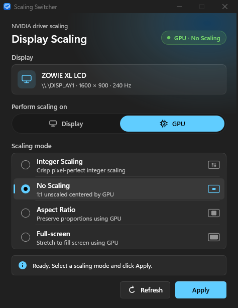

# Scaling Switcher

A ~40.5 KB portable native C++ app that switches NVIDIA Display vs. GPU scaling without installing or opening NVIDIA Control Panel or the NVIDIA App.



**[Download ScalingSwitcher.exe (v1.0.0)](https://github.com/taanioi/ScalingSwitcher/releases/latest/download/ScalingSwitcher.exe)** · [Release Notes & SHA-256](https://github.com/taanioi/ScalingSwitcher/releases/latest) *(no install or admin rights required)*

## Requirements & Notes

- **64-bit Windows 10/11 + NVIDIA GPU only** (`nvapi64.dll` in `System32`). Fluent Dark/Light UI on Windows 10 and 11 (automatically matches your Windows theme).
- **Multi-monitor support:** when 2+ NVIDIA displays are connected, click **Target display** (`F4` / `1`–`9`) to switch between monitors with position hints (`Primary`, `Left`, `Right`, `Above`, `Below`) and active scaling pills, or click **Identify** (`I`) to flash numbered badges on each screen.
- **GPU - Integer Scaling** needs Turing (GTX 16 / RTX 20 series) or newer and is disabled by NVIDIA while DSC or DSR is active.
- **Display scaling** needs a monitor hardware scaler wired to the NVIDIA GPU. Many Optimus laptops route the internal screen through the integrated GPU, leaving only GPU scaling there.
- **Scope:** sets the `NV_SCALING` mode only (not the per-game override), groups mirrored displays under one entry, and is visible only at resolutions below native.

<details>
<summary>Verification, building from source & NVAPI mapping</summary>

### Verification

Releases are built from source in [GitHub Actions](.github/workflows/build.yml) with a SHA-256-verified `w64devkit`. The `.exe` makes no network calls, statically imports only `KERNEL32` and `USER32`, and loads `nvapi64.dll`, `d2d1.dll`, `dwrite.dll` and `dwmapi.dll` from `System32` only. Unsigned binaries may trigger SmartScreen until widely downloaded; compare the hash below against the `sha256` digest shown beside `ScalingSwitcher.exe` on the [Release page](https://github.com/taanioi/ScalingSwitcher/releases/latest) or build it yourself:

```powershell
Get-FileHash .\ScalingSwitcher.exe -Algorithm SHA256
```

### Building from Source

Needs a 64-bit MinGW-w64 toolchain (`g++.exe`, `windres.exe`; e.g. [w64devkit](https://github.com/skeeto/w64devkit/releases)) in `PATH` or `%LOCALAPPDATA%\w64devkit\bin`, then:

```powershell
.\build.ps1
```

### NVAPI Mapping

| Mode | `NV_SCALING` |
| --- | --- |
| Display - No Scaling | `7` (`GPU_SCANOUT_TO_CLOSEST`) |
| Display - Aspect Ratio | `6` (`GPU_SCALING_TO_ASPECT_SCANOUT_TO_CLOSEST`) |
| Display - Full-screen | `1` (`GPU_SCALING_TO_CLOSEST`) |
| GPU - Integer Scaling | `8` (`GPU_INTEGER_ASPECT_SCALING`) |
| GPU - No Scaling | `3` (`GPU_SCANOUT_TO_NATIVE`) |
| GPU - Aspect Ratio | `5` (`GPU_SCALING_TO_ASPECT_SCANOUT_TO_NATIVE`) |
| GPU - Full-screen | `2` (`GPU_SCALING_TO_NATIVE`) |

</details>

Licensed under the [MIT License](LICENSE).
